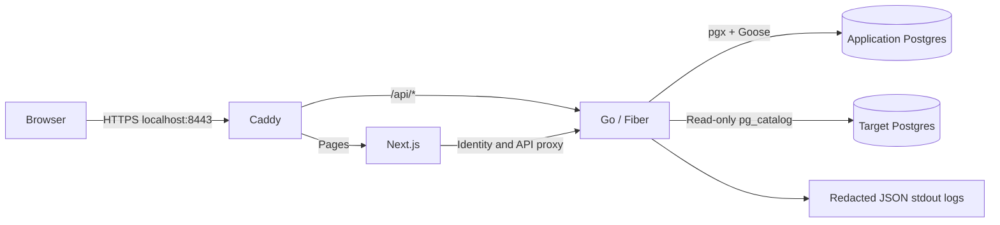

# Architecture

Schewise is a monorepo with one Go module and a pnpm workspace. Go owns
identity, authorization, application metadata, PostgreSQL catalogs, and future
AI behavior. Next.js owns presentation and page redirects.

The application database contains units, roles, flat permissions, assignments,
users, invitations, password resets, sessions, audit records, and migration
state. It is separate from any target database that a user connects. Application
migrations must never be applied to a target connection.

## Boundaries and choices

- **Monorepo:** API, UI, contracts, and integration checks can change in one PR.
- **One Go module:** root tooling covers all packages; `internal/` keeps
  implementation private. `cmd/api` owns startup/shutdown; `cmd/migrate` exposes
  application migration up/status commands.
- **Fiber and Zap:** selected for this authentication milestone. HTTP handlers
  delegate password/session/account operations to `internal/auth`. Logs use Zap
  with explicit safe fields, never body/header/query dumps.
- **Postgres and pgx:** persist application identity/session/audit state through
  database/sql, shared with Goose. The application role owns only its database
  and has no cluster administration privileges.
- **Goose:** embedded SQL migrations with advisory locking, applied at startup
  or explicitly through the CLI. Successful mutations and audit events share a
  database transaction.
- **Next.js:** App Router, strict TypeScript, server-side identity checks, and
  `proxy.ts` page protection. A client cookie's presence alone grants no access.
  Go authorizes protected APIs independently.
- **HTTPS:** the development Caddy gateway issues local certificates. Client CA
  trust is explicit. Cookies remain Secure/HttpOnly/SameSite=Lax, with opaque
  sessions stored as digests and synchronizer CSRF protection.
- **Authorization:** `internal/rbac` owns the permission catalog, scoped
  additive engine, hierarchy, role/assignment repositories, and impact previews.
  One permanent root and four immutable system roles are seeded. `Can` resolves
  persisted assignments and resource ownership; no handler or auth service
  authorizes by a role name or browser claim. System-level permissions require
  root assignments. Metadata mutations and their audit records share a
  transaction and a common advisory lock. Step 2B exposes the permission-gated
  unit/role/assignment API and monochrome administration UI. Read projections
  redact inaccessible ancestors per assignment; Go alone determines capability
  flags. Inheritance boundaries stop ancestor grants while retaining built-in
  root Administrator bypasses. `CanRevoke` centralizes revoke authority. Public
  registration is bootstrap-only; all later accounts use invitations.
- **API contracts:** `internal/apicontract` defines request/response DTOs and
  the administration route manifest used by Fiber registration and the OpenAPI
  3.1 generator. `openapi-typescript` generates frontend types; `openapi-fetch`
  checks request paths, bodies, CSRF headers, and response types at compilation.
  CI rejects stale generated files. These dependencies address contract drift
  without adding another HTTP framework or duplicating domain logic in Next.js.

See [ADR 0001](adr/0001-foundation.md) for the original foundation and
[ADR 0002](adr/0002-authentication.md) for the HTTP, storage, and auth update.
[ADR 0003](adr/0003-scoped-rbac.md) updates the authorization model;
[ADR 0004](adr/0004-administration-api.md) records the administration contract
and inherited-source privacy boundary.
[ADR 0005](adr/0005-inheritance-boundaries.md) adds inheritance boundaries and
centralized revocation. [Authentication](authentication.md) documents guarantees
and deployment limits; [authorization](authorization.md) describes the engine,
repositories, and administration API.

## Database versioning direction

Git-like review/history is the product direction; database recovery has
additional constraints. Schema observations are implemented; the remaining
capabilities are planned:

| Concept            | Meaning                                                        |
| ------------------ | -------------------------------------------------------------- |
| Schema snapshot    | Versioned tables, columns, relations, types, and constraints   |
| Schema diff        | Comparison between schema snapshots                            |
| Migration plan     | Ordered operations targeting an environment's schema           |
| Data snapshot      | Separate, potentially sensitive copies of records              |
| Environment state  | Observed schema and applied change history for a connection    |
| Restore / rollback | Explicit recovery with engine- and backup-dependent guarantees |

An old schema snapshot cannot recover deleted records. Future execution must
show the environment, privileges, drift, plan, and data-loss implications.
Transaction and DDL behavior must be evaluated per connector. Environment names
such as staging are separate from a Git staging area.

PostgreSQL catalog snapshots are implemented. Change execution, mock database
endpoints, mapping/harmonization, AI assistance remain future work. Record
material designs as ADRs and extend the [roadmap](roadmap.md) without treating
planned features as implemented.

## Invite-only onboarding

`internal/auth` owns invitations alongside identity/session transactions.
`internal/onetimetoken` supplies reusable random tokens, SHA-256 storage
digests, and constant-time verification; token purpose, expiry, and consumption
live in callers. Migration 00004 adds `invites` and `users.display_name`
additively. Invite records preserve stale role/scope IDs so deleting a target
does not destroy history or consume the link. Acceptance revalidates the current
pair and issuer permissions under the shared metadata advisory lock, then
creates user, assignment, session, used state, and audits atomically. A trigger
enforces the one-active-email invariant with the same lock because expiry cannot
appear in an immutable partial index.

No SMTP is installed. An optional `auth.Mailer` runs after commit with a no-op
default; a transport failure never rolls back a committed invitation or logs
transport error details. A future durable delivery mechanism would need its own
review. Account settings and admin-issued password reset are implemented; email
change, 2FA, and personal access tokens are separate milestones.

## Account settings and recovery

Migration 00005 preserves the existing `users.is_active` column and last-admin
triggers, adds last-login/session metadata and non-secret session UUIDs, and
creates `password_resets`. `internal/auth` owns profile, credential, session,
and reset operations; `internal/rbac.SetUserActive` remains the single status
mutation with its existing permission/last-admin guards. Every security mutation
and its audits share the metadata lock and a transaction. Login compares the
verified hash with the live hash under that lock, preventing a password verified
before a reset/change from creating a new session afterward.

The self-service API resolves the account from a live session, never a user ID
in the body/query. Self access reuses the RBAC effective-permission and origin
projections inside one snapshot; accounts with no readable units receive an
empty list. Account pages remain reachable without organization permissions.
Admin APIs enforce live root `Can(user:manage)`; no role name is an authority.
Password reset uses the shared token helper and independent purpose-specific
storage, never exposes hashes/tokens in list APIs, and does not create a login
session. Credential changes and deactivation revoke pending reset links.

`SCHEWISE_STORE_SESSION_IP` defaults true and can omit new session/IP logs;
`SCHEWISE_PASSWORD_RESET_TTL` defaults 24h. Session activity is updated at most
once per five minutes. Device strings are untrusted/truncated at storage and
coarsened at display. Both public token page families use no-referrer/no-store
headers and excluded auth-proxy routes; API Origin/CSRF checks remain mandatory.

## PostgreSQL catalog snapshots

`internal/connections` owns encrypted profiles, destination policy, pgx catalog
sessions, and normalized structural snapshots. HTTP transport stays in
`internal/httpapi`; generated contracts cover the new Next.js routes. Migration
00006 adds connections/snapshots and validates connection-scoped assignments
with a generated FK. The default RBAC SQL resolver now reads real ownership.

AES-256-GCM keys come only from server environment. Snapshot structure/comments
are SHA-256 hashed independently of volatile statistics; unchanged syncs update
the latest stats. Target I/O runs under a per-connection transaction advisory
lock without holding the global metadata lock; authorization is rechecked under
that global lock before committing local state and audits. Deletion requires a
name confirmation and cascades only metadata for that connection. No target
mutation is implemented. See [connections](connections.md) for the API, host
policy/SSRF boundary, read-only guarantees, limits, and fixtures.

[ADR 0006](adr/0006-postgres-connections.md) records the Step 5 storage,
locking, and read-only connector decisions.
