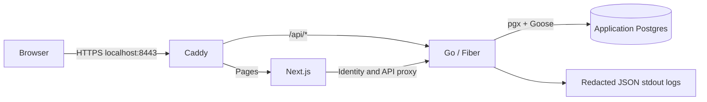

# Architecture

Schewise is a monorepo with one Go module and a pnpm workspace. Go owns
identity, authorization, application metadata, and future database/AI domain
behavior. Next.js owns presentation and page redirects.

The application database contains roles, users, sessions, audit events, and
migration state. It is separate from any future target database that a user
connects. Application migrations must never be applied to a target connection.

## Boundaries and choices

- **Monorepo:** API, UI, contracts, and integration checks can change in one PR.
- **One Go module:** root tooling covers all packages; `internal/` keeps
  implementation private. `cmd/api` owns startup/shutdown; `cmd/migrate` exposes
  application migration up/status commands.
- **Fiber and Zap:** selected for this authentication milestone. HTTP handlers
  delegate password/session/account operations to `internal/auth`. Logs use Zap
  with explicit safe fields, never body/header/query dumps.
- **Postgres and pgx:** persist application identity/session/audit state through
  database/sql, shared with Goose. The application role owns only its database
  and has no cluster administration privileges.
- **Goose:** embedded SQL migrations with advisory locking, applied at startup
  or explicitly through the CLI. Successful mutations and audit events share a
  database transaction.
- **Next.js:** App Router, strict TypeScript, server-side identity checks, and
  `proxy.ts` page protection. A client cookie's presence alone grants no access.
  Go authorizes protected APIs independently.
- **HTTPS:** the development Caddy gateway issues local certificates. Client CA
  trust is explicit. Cookies remain Secure/HttpOnly/SameSite=Lax, with opaque
  sessions stored as digests and synchronizer CSRF protection.
- **Roles:** Administrator is the only seeded role and can create accounts and
  revoke sessions. Public registration and custom role editing are absent.

See [ADR 0001](adr/0001-foundation.md) for the original foundation and
[ADR 0002](adr/0002-authentication.md) for the HTTP, storage, and auth update.
[Authentication](authentication.md) documents guarantees and deployment limits.

## Database versioning direction

Git-like review/history is the product direction; database recovery has
additional constraints. These remain future capabilities:

| Concept            | Meaning                                                        |
| ------------------ | -------------------------------------------------------------- |
| Schema snapshot    | Versioned tables, columns, relations, types, and constraints   |
| Schema diff        | Comparison between schema snapshots                            |
| Migration plan     | Ordered operations targeting an environment's schema           |
| Data snapshot      | Separate, potentially sensitive copies of records              |
| Environment state  | Observed schema and applied change history for a connection    |
| Restore / rollback | Explicit recovery with engine- and backup-dependent guarantees |

An old schema snapshot cannot recover deleted records. Future execution must
show the environment, privileges, drift, plan, and data-loss implications.
Transaction and DDL behavior must be evaluated per connector. Environment names
such as staging are separate from a Git staging area.

Target connectors, schema history, change execution, mock database endpoints,
mapping/harmonization, AI assistance, and collaborative project permissions
remain future work. Record material designs as ADRs and extend the
[roadmap](roadmap.md) without treating planned features as implemented.
