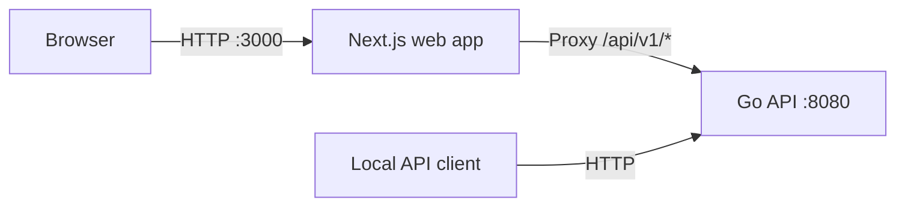

# Architecture

## Current implementation

Schewise starts as a monorepo with one Go module at the root and a pnpm
workspace for the Next.js web app. It runs entirely on localhost and has no
persistence or external service requirements.

The only API endpoint is `GET /api/v1/health` (also supports `HEAD`). It reports
process liveness with `{"status":"ok","service":"schewise-api"}`. Other routes
return 404; unsupported methods return 405. It does not imply that a database is
connected or healthy.

## Why these boundaries

- **Monorepo:** API contracts, UI, documentation, and integration checks can
  change in one pull request. A single pnpm workspace is sufficient without an
  extra orchestration tool.
- **One root Go module:** simplifies `go test ./...`, tooling, and imports.
  `internal/` prevents external consumers from depending on implementation
  packages. `cmd/api` owns startup, environment configuration, signal handling,
  and graceful shutdown.
- **Go standard-library HTTP:** provides routing, timeouts, logging, and testing
  support for the current scope without framework coupling. Domain packages and
  connector interfaces should emerge from actual use cases.
- **Next.js App Router and strict TypeScript:** provide the web application
  boundary with Server Components by default and small Client Components for
  interaction. The starter uses plain CSS and system fonts to avoid an
  unnecessary UI dependency or font download during builds.
- **Same-origin API proxy:** browser requests use `/api/v1/*`; Next.js forwards
  them to Go. This avoids a separate browser CORS configuration for local use.
  Domain logic and future database/AI access remain in Go.
- **Reproducible tooling:** exact JavaScript dependency versions and a committed
  lockfile; a preferred Go toolchain; pinned GitHub Actions and automated
  updates. Node and Docker base-image release lines receive patch updates.
- **Local first:** no authentication, application database, queue, AI SDK, or
  deployment target is selected in this phase. Development containers are an
  optional way to run the same two services.

See [ADR 0001](adr/0001-foundation.md) for the initial decision record.

## Database versioning: design direction

The product should support Git-like review and history, but databases have
different state and recovery constraints. Keep these concepts distinct in future
designs:

| Concept             | Meaning                                                                   |
| ------------------- | ------------------------------------------------------------------------- |
| Schema snapshot     | Versioned metadata describing tables, columns, constraints, and relations |
| Schema diff         | A comparison of two schema snapshots                                      |
| Migration plan      | Ordered operations intended to move an environment toward a target schema |
| Data snapshot       | A separate, potentially large and sensitive copy of database records      |
| Environment state   | Observed schema and applied change history for a particular connection    |
| Restore or rollback | An explicit recovery operation whose safety depends on available state    |

Checking out an old schema snapshot does not restore deleted records.
Destructive changes may require a backup, a compensating migration, or may be
irreversible. Future designs must show a plan, target environment, drift,
required privileges, and data-loss implications before execution. Cross-engine
transaction and DDL behavior must be evaluated per connector.

Environment names such as development, staging, and production are product
concepts, separate from a Git staging area or an uncommitted schema change.

## Future capability boundaries

These are directions, not existing packages or committed implementations:

- Connections and environment metadata, with scoped secret handling.
- Schema introspection, canonical snapshots, diffs, and history.
- Change planning, review, execution, drift detection, and recovery.
- Mock datasets and connectable mock database endpoints for API development.
- Schema mapping and data harmonization with validation and lineage.
- AI assistance for explanations and proposals, with explicit provider/data
  policies and human review before mutations.
- Collaboration, access control, project sharing, and audit trails.

Choose the first supported database engine, metadata store, snapshot format, and
AI provider only when the corresponding capability is designed. Record material
decisions as ADRs.
